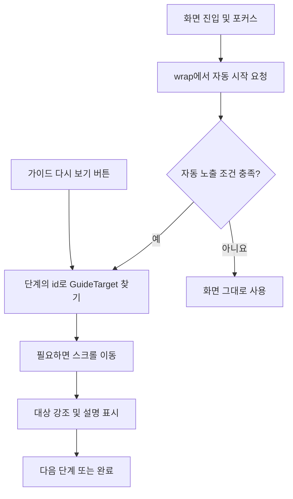

# 새 화면에 가이드 기능 적용하기

새 화면의 버튼이나 입력 영역을 순서대로 강조하고 설명을 보여주는 방법입니다.
공통 가이드 모듈을 사용하므로, 화면마다 오버레이를 새로 만들 필요가 없습니다.

> 이 문서는 `wip-application-v2`의 현재 구현을 기준으로 작성했습니다. 아래 코드의 경로는 모두 애플리케이션 저장소 기준입니다.

## 1. 전체 흐름 이해하기

가이드 하나를 **투어(Tour)**, 투어 안의 안내 한 개를 **단계(Step)**라고 부릅니다.
`GuideTarget`은 화면에서 강조할 영역을 지정하는 컴포넌트입니다.



새 화면에서는 다음 작업을 합니다.

1. 안내 순서와 문구를 정의합니다.
2. `createFeatureGuide()`로 화면용 가이드를 만듭니다.
3. 안내할 요소를 `GuideTarget`으로 감쌉니다.
4. 화면을 `wrap()`으로 감싸고 다시 보기 버튼을 연결합니다.

## 2. 공통 설정 확인하기

`app/_layout.tsx`에는 이미 아래 구조가 적용되어 있습니다. **새 화면에 Provider나 Overlay를 추가하지 마세요.**
다음 코드는 위치를 이해하기 위한 축약본입니다. 기존 루트 파일을 교체하지 않습니다.

```tsx
import { GuideProvider, GuideOverlay } from "@features/guide";
import { guideStorage } from "@utils/guide_storage";

// 기존 SafeAreaProvider 내부
<GuideProvider storage={guideStorage}>
  <Layout />
  {/* 기존 전역 UI */}
  <GuideOverlay />
</GuideProvider>;
```

- `GuideProvider`: 공통 설정과 노출 기록 저장소를 제공합니다.
- `GuideOverlay`: 배경을 어둡게 하고 대상과 설명을 표시합니다. 앱 루트에 한 번만 둡니다.
- `guideStorage`: 앱을 다시 실행해도 이전 노출 기록을 유지합니다.

## 3. 예제로 적용하기

예시는 `sample_search`라는 새 검색 화면입니다. 검색어 입력과 검색 버튼을 차례로 안내합니다.
실제 적용할 때는 기능명, 안내 문구, 대상 컴포넌트를 자신의 화면에 맞게 바꾸세요.

```text
src/features/sample_search/
├── constants/
│   └── sample_search_tour_constant.ts  # 안내 순서와 문구
├── guide.ts                           # 화면용 가이드 생성
└── screens/
    └── SampleSearchScreen.tsx         # 대상 및 시작 연결
```

### 3-1. 안내 순서와 문구 정의하기

파일: `src/features/sample_search/constants/sample_search_tour_constant.ts`

```ts
import type { GuideTour } from "@features/guide";

export const SAMPLE_SEARCH_TOUR: GuideTour = {
  id: "sample_search",
  version: 1,
  visibility: "once",
  steps: [
    {
      id: "sampleSearch.keyword",
      title: "검색어 입력",
      description: "찾고 싶은 약의 이름을 입력해 주세요.",
    },
    {
      id: "sampleSearch.submit",
      title: "검색 실행",
      description: "이 버튼을 누르면 검색 결과를 확인할 수 있어요.",
    },
  ],
};
```

| 항목         | 의미                                                                |
| ------------ | ------------------------------------------------------------------- |
| 투어의 `id`  | 가이드 전체의 고유 이름. 다른 투어와 겹치지 않게 작성합니다.        |
| `version`    | 가이드 콘텐츠 버전. 기존 사용자에게 다시 자동 노출하려면 올립니다.  |
| `visibility` | 자동 노출 정책. `once`는 같은 버전에서 한 번만 자동으로 보여줍니다. |
| `steps`      | 배열에 작성한 순서대로 안내합니다.                                  |
| 단계의 `id`  | 화면의 `GuideTarget id`와 정확히 일치해야 합니다.                   |

`description`은 필수이고, `title`은 생략할 수 있습니다.

### 3-2. 화면용 가이드 만들기

파일: `src/features/sample_search/guide.ts`

```ts
import { createFeatureGuide } from "@features/guide";
import { SAMPLE_SEARCH_TOUR } from "./constants/sample_search_tour_constant";

export const sampleSearchGuide = createFeatureGuide(SAMPLE_SEARCH_TOUR);
```

`createFeatureGuide()`는 파일 최상위에서 한 번 호출합니다. 컴포넌트 안에서 매번 만들지 않습니다.

### 3-3. 화면에 대상과 시작 연결하기

파일: `src/features/sample_search/screens/SampleSearchScreen.tsx`

```tsx
import React, { useState } from "react";
import { Button, ScrollView, StyleSheet, TextInput } from "react-native";
import { GuideTarget, useGuideScroll } from "@features/guide";
import { sampleSearchGuide } from "../guide";

const SampleSearchScreen = () => {
  const [keyword, setKeyword] = useState("");
  const replay = sampleSearchGuide.useReplay();
  const guideScroll = useGuideScroll();

  const handleSearch = () => {
    // 여기에 실제 화면의 검색 로직을 연결하세요.
  };

  return (
    <ScrollView {...guideScroll} contentContainerStyle={styles.content}>
      <Button title="가이드 다시 보기" onPress={replay} />

      <GuideTarget id="sampleSearch.keyword" style={styles.target}>
        <TextInput
          value={keyword}
          onChangeText={setKeyword}
          placeholder="약 이름 입력"
          style={styles.input}
        />
      </GuideTarget>

      <GuideTarget id="sampleSearch.submit" style={styles.target}>
        <Button title="검색" onPress={handleSearch} />
      </GuideTarget>
    </ScrollView>
  );
};

const styles = StyleSheet.create({
  content: { padding: 20 },
  target: { marginTop: 16 },
  input: { borderWidth: 1, borderColor: "#999", padding: 12 },
});

export default sampleSearchGuide.wrap(SampleSearchScreen);
```

**이 예제에서 꼭 확인할 부분은 네 가지입니다.**

- `GuideTarget id`를 단계의 `id`와 동일하게 작성합니다.
- `wrap()`으로 감싼 컴포넌트를 export해야 화면에 포커스가 올 때 자동 시작합니다.
- `useReplay()`는 컴포넌트 최상위에서 호출하고, 반환된 함수를 `onPress`에 전달합니다. 수동 재생은 자동 노출 정책과 관계없이 동작합니다.
- 스크롤 화면은 `useGuideScroll()`의 반환값을 `ScrollView`에 연결합니다. 스크롤이 없는 화면은 이 훅 없이 `View`를 사용하면 됩니다.

예제의 검색 함수는 연결 위치만 보여줍니다. 실제 화면의 검색 함수로 교체하세요.

### 3-4. 라우트에서 감싼 화면 사용하기

기존 화면에 적용한다면 기존 라우트가 `wrap()`으로 감싼 화면을 가져오는지 확인하세요.
예제 화면을 새 라우트로 연결할 경우 다음처럼 작성할 수 있습니다.

파일: `app/sample-search/index.tsx`

```tsx
export { default } from "@features/sample_search/screens/SampleSearchScreen";
```

메뉴나 버튼에서 이 화면으로 이동하는 연결은 기존 화면 추가 방식에 맞춰 구성합니다.

## 4. 기존 공통 헤더의 ? 버튼 사용하기

화면 안의 다시 보기 버튼 대신 **공통 헤더에 도움말 기능이 있는 화면**에서는 아래 방식으로 연결할 수 있습니다.
`PillIdentificationSearchScreen.tsx`가 이 방식을 사용합니다.

아래 import와 훅을 화면 컴포넌트에 추가하고, 예제의 화면 내부 다시 보기 버튼은 제거합니다.

```tsx
import { useCallback } from "react";
import { useFocusEffect } from "expo-router";
import { useHeaderActionStore } from "@layouts/header/store/header_action_store";

// 화면 컴포넌트 내부: 기존 replay 선언 다음에 추가
useFocusEffect(
  useCallback(() => {
    useHeaderActionStore.getState().setHelp(replay);

    return () => {
      if (useHeaderActionStore.getState().onHelp === replay) {
        useHeaderActionStore.getState().setHelp(null);
      }
    };
  }, [replay]),
);
```

화면에 포커스가 오면 도움말 함수를 등록하고, 포커스를 잃으면 자신의 등록을 해제합니다.
다른 화면의 도움말 함수가 남지 않도록 정리 함수까지 함께 작성하세요.

## 5. 자주 바꾸는 설정

| 설정                   | 사용할 값                                                    | 기본값      |
| ---------------------- | ------------------------------------------------------------ | ----------- |
| 투어 `visibility`      | `once`: 한 번 / `always`: 포커스 시마다 / `never`: 수동 전용 | `once`      |
| 투어 `version`         | 기존 기록보다 큰 정수로 올리면 `once` 가이드 재노출          | `1`         |
| 투어 `tooltipMode`     | `button`: 버튼 진행 / `slide`: 좌우 스와이프 진행            | `button`    |
| 투어 `animation`       | `fade`, `scale`, `none`                                      | `fade`      |
| 단계 `shape`           | `rectangle`, `circle`                                        | `rectangle` |
| 단계 `padding`         | 강조 영역 바깥 여백                                          | `8`         |
| 단계 `tooltipPosition` | `auto`, `top`, `bottom`                                      | `auto`      |

`tooltipMode`와 `animation`은 투어에서 생략하면 Provider 설정을 따릅니다. 표는 현재 공통 기본값입니다.

**한 번 본 가이드가 다시 나오지 않는 경우**

`once` 기록은 완료할 때가 아니라 **자동 시작 전에 저장**합니다. 중간에 건너뛰어도 같은 버전은 다시 자동으로 나오지 않습니다.
개발 중에는 다시 보기 버튼으로 확인하세요. 배포할 때 기존 사용자에게 변경된 가이드를 다시 보여줘야 한다면 `version`을 `1`에서 `2`처럼 올립니다. 투어 `id`는 유지합니다.

## 6. 적용할 때 주의할 점

- **대상은 시작할 때 화면에 렌더링되어 있어야 합니다.** 로딩 후 나타나는 요소는 준비가 끝난 뒤 시작하도록 별도 연결이 필요합니다. `wrap()`은 데이터 로딩 완료를 기다리지 않습니다.
- **ID는 구분해서 작성합니다.** `sampleSearch.keyword`처럼 기능명을 포함하세요. 함께 마운트된 대상의 ID가 중복되면 마지막에 등록된 대상이 사용됩니다.
- **GuideTarget은 View를 하나 추가합니다.** 가로 배치가 달라지면 필요한 `flex`나 `width`를 `GuideTarget`의 `style`에도 지정하세요.
- **기존 스크롤 이벤트를 덮어쓰지 마세요.** 기존 `onScroll`이 있다면 그 안에서 `guideScroll.onScroll(event)`도 호출해야 합니다. 기존 `ref`도 있다면 두 ref가 같은 ScrollView를 가리키도록 연결해야 합니다.
- **자동 스크롤은 기본 ScrollView 예제를 기준으로 적용합니다.** 컨트롤러는 전역에 하나만 등록됩니다. 중첩 스크롤, 여러 스크롤 영역, 아직 렌더링되지 않은 FlatList 항목은 추가 구현 없이 지원된다고 가정하지 마세요.
- **네이티브 Modal 안의 대상은 별도 확인이 필요합니다.** 루트 오버레이와 측정 기준 창이 달라질 수 있습니다. 일반 화면 예제를 그대로 적용하지 마세요.

## 7. 적용 후 확인하기

- [ ] 처음 화면에 진입하면 가이드가 시작됩니다.
- [ ] 단계 순서대로 올바른 요소가 강조됩니다.
- [ ] 다음, 이전, 완료, 건너뛰기가 정상 동작합니다.
- [ ] 화면을 나갔다 돌아와도 `once` 가이드가 다시 자동으로 나오지 않습니다.
- [ ] 앱을 다시 실행해도 같은 버전의 노출 기록이 유지됩니다.
- [ ] 다시 보기 버튼으로 첫 단계부터 재생할 수 있습니다.
- [ ] 긴 화면에서는 아래쪽 대상까지 자동 스크롤됩니다.
- [ ] Android와 iOS에서 강조 위치, 설명 위치, 기존 화면 배치가 자연스럽습니다.

## 8. 실제 구현 참고 위치

아래 경로는 모두 `wip-application-v2` 저장소 기준입니다.

| 참고할 내용           | 파일                                                                                            |
| --------------------- | ----------------------------------------------------------------------------------------------- |
| 공통 공개 API         | `src/features/guide/index.ts`                                                                   |
| 투어 및 단계 타입     | `src/features/guide/types/guide_type.ts`                                                        |
| 앱 공통 설정          | `app/_layout.tsx`                                                                               |
| 짧은 버튼 안내 정의   | `src/features/pill_save/constants/pill_save_tour_constant.ts`                                   |
| 화면 내부 도움말 연결 | `src/features/pill_save/screens/PillSave.tsx`                                                   |
| 공통 헤더 도움말 연결 | `src/features/pill_identification_search/screens/PillIdentificationSearchScreen.tsx`            |
| 스크롤과 대상 연결    | `src/features/pill_identification_search/components/organisms/PillIdentificationSearchForm.tsx` |
