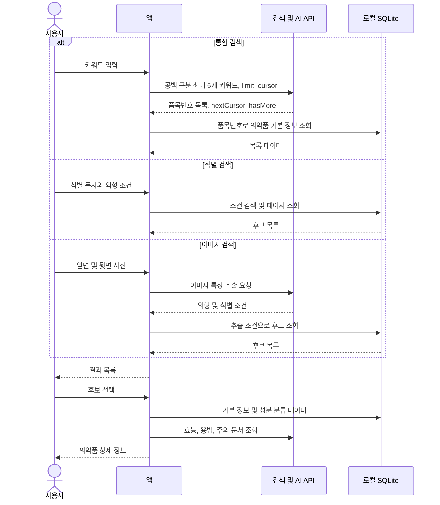
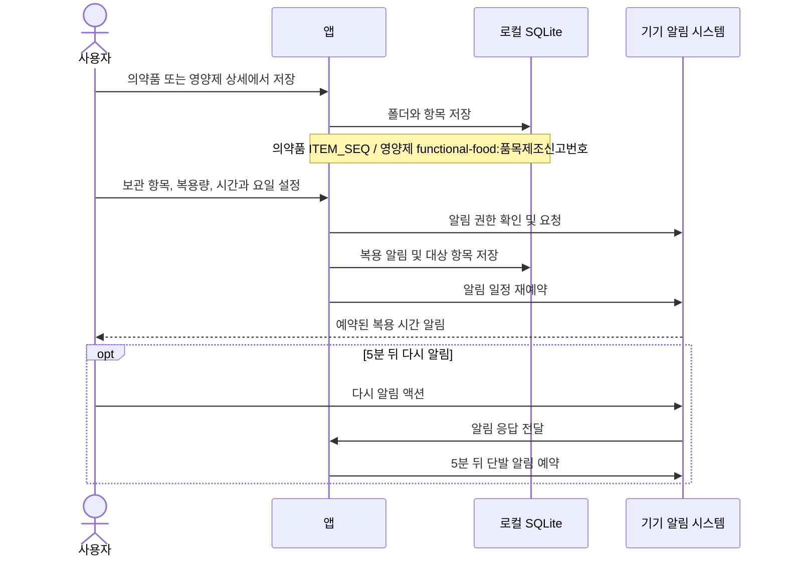
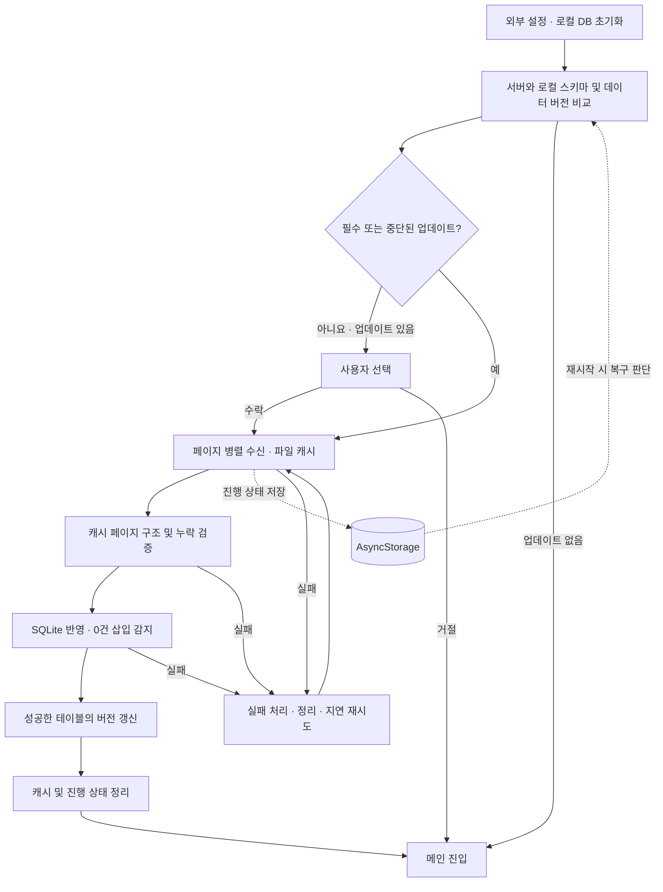

# 데이터 흐름

기준과 소스 경로는 [애플리케이션 구조](../development/application_architecture.md)를 참고합니다.

## 의약품 검색

통합 검색의 원격 번호와 로컬 데이터 버전이 다르면 조회 가능한 항목 수가 달라질 수 있습니다. `totalDataCount`를 서버 전체 검색 건수라고 단정하지 않습니다. 상세 기본 정보는 원격 문서보다 먼저 표시될 수 있으며 원격 실패 시 일부 내용이 제한됩니다.

## 보관 및 복용 관리

`복용 완료` 액션은 현재 안내 토스트를 표시하며 복용 이력을 DB에 누적하지 않습니다.

## 공공 리소스 동기화

전체 업데이트가 하나의 트랜잭션으로 원자 교체되는 구조는 아닙니다. 테이블·삽입 배치 단위 처리와 실패 후 재시도를 사용합니다. OS가 앱을 중지한 동안의 계속 실행을 보장하지 않으며, 복귀·재실행 시 저장 상태로 복구합니다.
