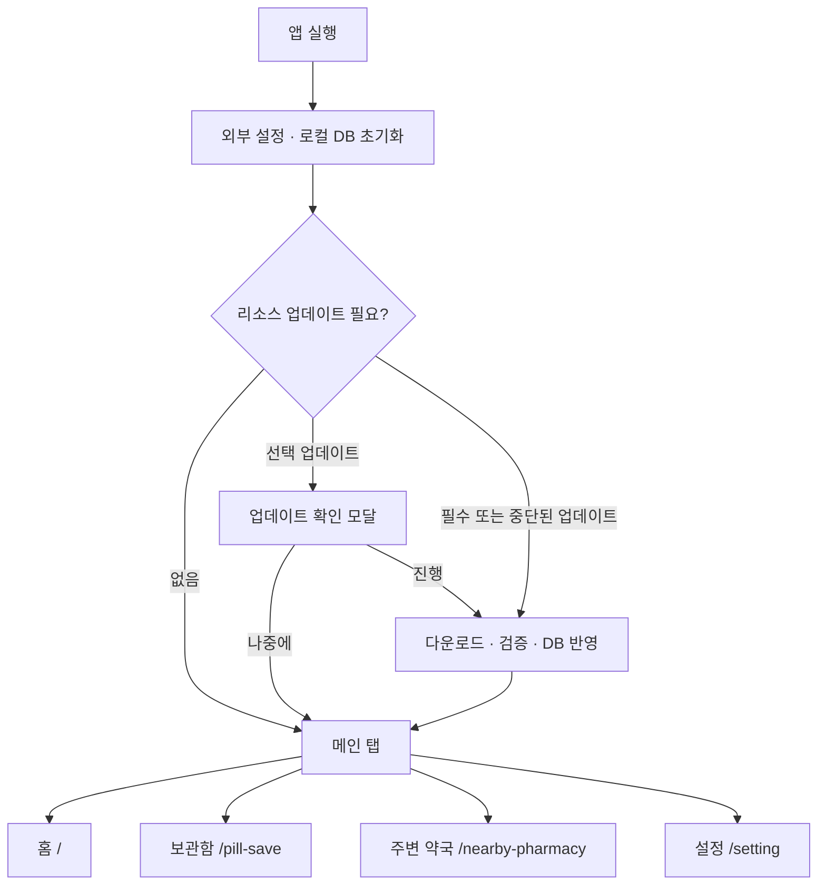
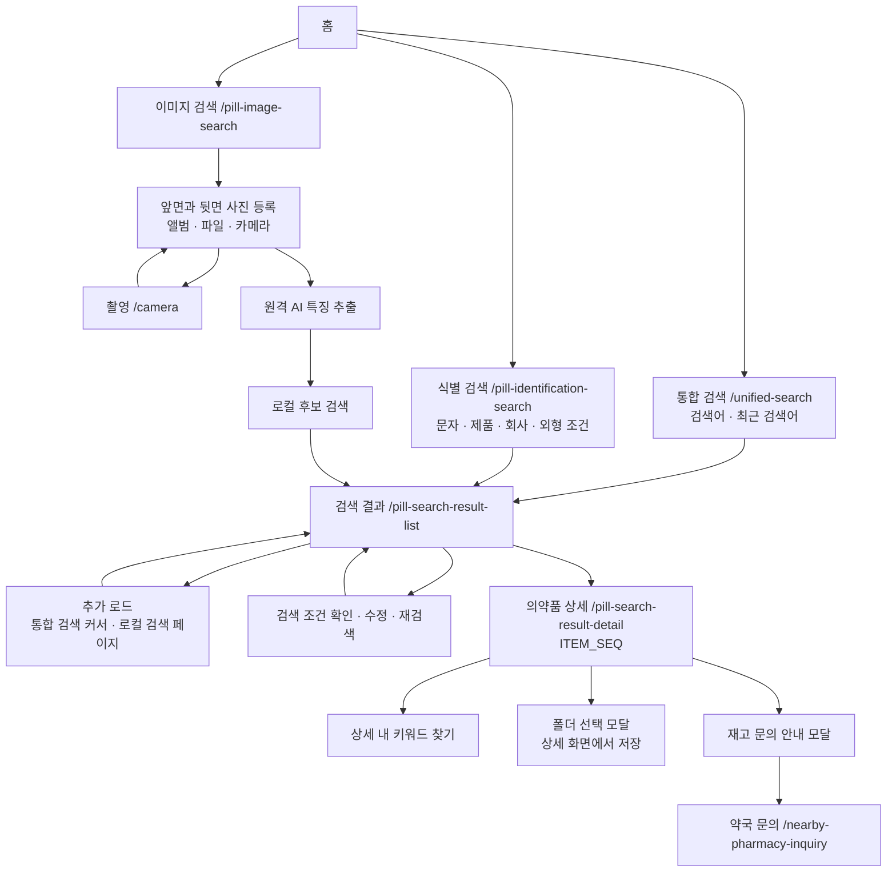
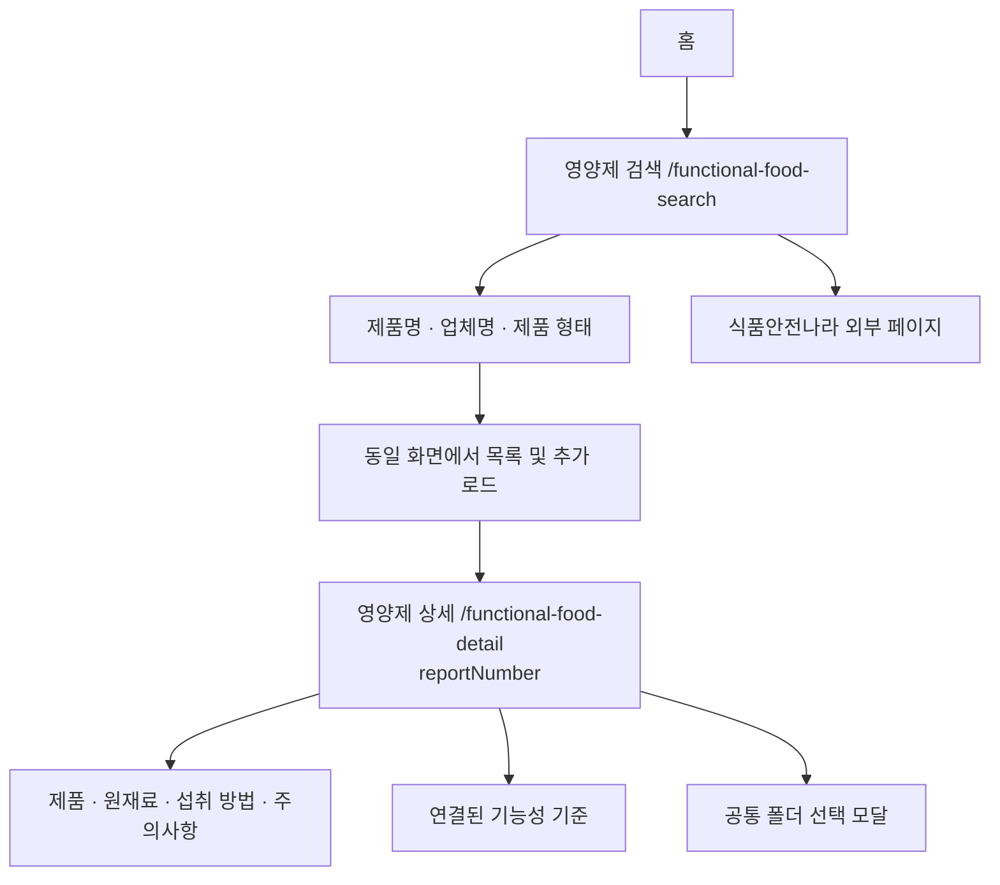
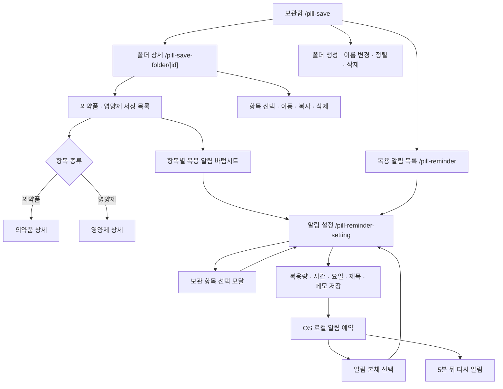
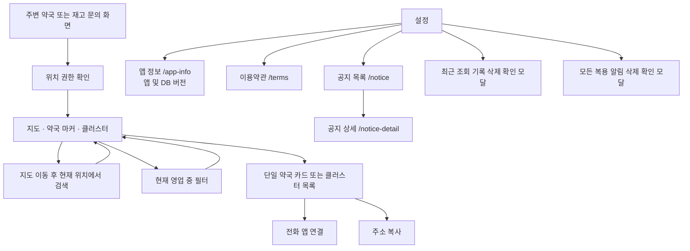

# 화면 흐름

`app/`의 Expo Router 경로와 기능별 이동 코드를 기준으로 작성했습니다. 화면 안의 모달·바텀시트와 별도 라우트를 구분합니다.

## 1. 시작 및 주요 진입

## 2. 의약품 검색 및 상세

이미지 검색에는 앞뒷면 사진이 모두 필요합니다. 특징 인식 실패·API 실패 시 안내 후 검색 화면에 머뭅니다. 통합 검색의 빈 결과도 안내 후 현재 화면에 머뭅니다. 상세 저장 버튼은 폴더 선택 모달을 열며 보관함 탭으로 즉시 이동하지 않습니다.

## 3. 영양제 검색 및 상세

## 4. 보관함 및 복용 알림

## 5. 주변 약국 및 설정

설정의 '기록 삭제'는 최근 조회 의약품 기록에 적용됩니다. 최근 검색어는 통합 검색 화면의 관리 기능과 구분합니다.
