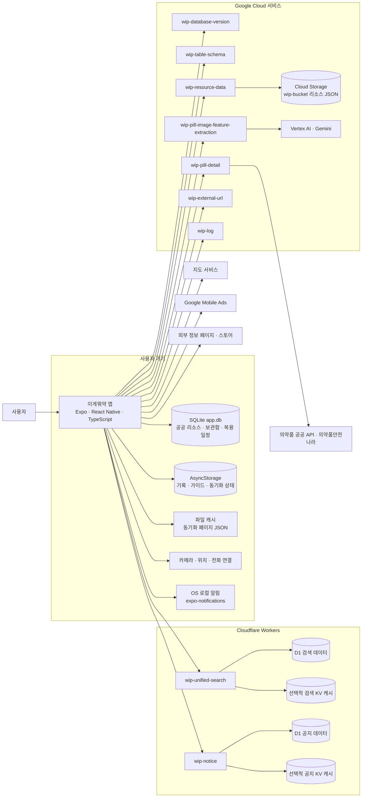
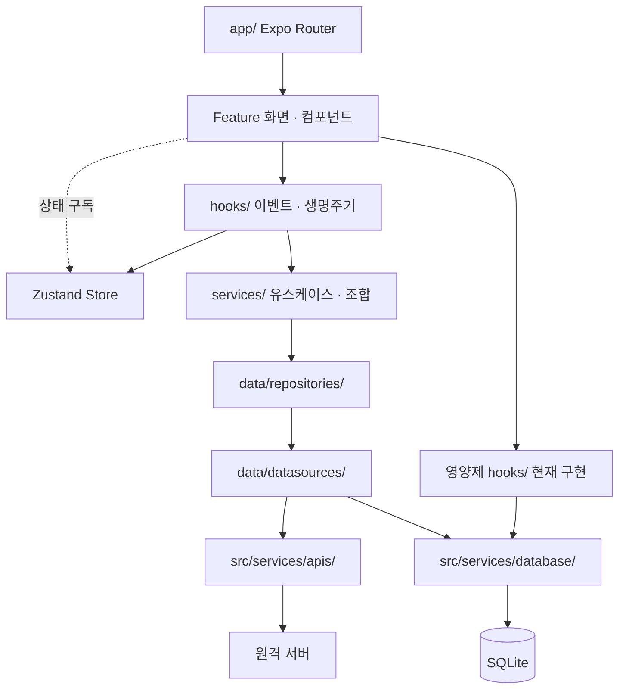
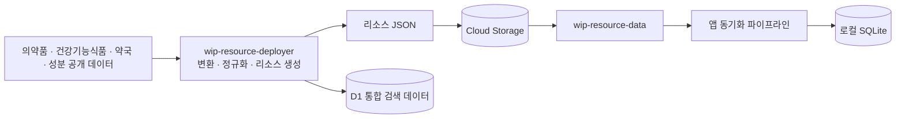

# 시스템 아키텍처

2026-11-14 로컬 코드 기준. 앱은 `wip-application-v2`, 서버는 `wip-serverless`, 리소스 가공은 `wip-resource-deployer`를 참고했습니다. GCP 영역은 저장소의 서비스 구분이며 실제 배포 구성·게이트웨이·리전의 확인을 의미하지 않습니다.

## 서비스 구성

## 앱 내부 계층

대부분의 기능은 훅 → 서비스 → 리포지토리 → 데이터 소스를 거칩니다. 영양제 조회 훅은 공통 DB 쿼리를 직접 호출하는 등 예외가 있으며 모든 모듈이 동일한 계층을 갖추었다고 가정하지 않습니다. 상태 저장소에도 일부 서비스 호출이 남아 있습니다.

## 리소스 공급

리소스 타입별 생성·업로드 지원 여부와 실행 설정을 확인한 뒤 운영합니다. 리소스 갱신 주기와 앱의 버전 기반 동기화는 [DB 업데이트 정책](../operation/database_update_policy.md)에서 구분합니다.

## 경계와 구현 근거

- 식별 검색·AI 분석 후 후보 조회·영양제 검색·약국 조회: 로컬 SQLite.
- 통합 검색: Workers가 품목번호와 커서를 반환하고 앱이 로컬 기본 정보를 결합.
- 의약품 상세: 로컬 기본 정보·성분 분류와 원격 효능·용법·주의 문서를 결합. 상세 문서를 AI로 생성하는 흐름은 아님.
- 보관함·복용 일정: 기기 SQLite. 알림은 OS에 예약.
- 가이드 노출 기록·최근 검색어·동기화 상태: AsyncStorage. 업데이트 JSON: 파일 캐시.
- API 연결: `src/services/apis/{google_cloud,cloud_flare}/`; DB: `src/services/database/`; 루트 초기화: `app/_layout.tsx`.
- 서버 AI: `wip-pill-image-feature-extraction/gemini.js`; 리소스 저장소: `wip-resource-data/resources.js`; Workers: `cloud_flare/`.

상세 경로와 제약은 [애플리케이션 구조](../development/application_architecture.md), 처리 순서는 [데이터 흐름](./data_flow.md)을 참고합니다.
